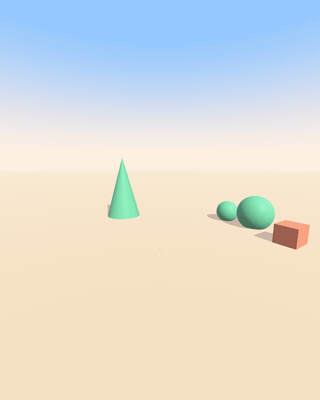
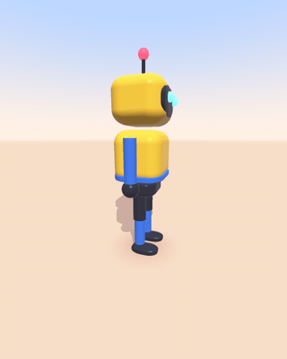
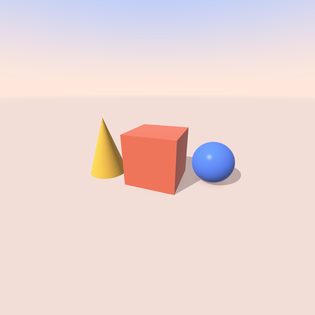

<div align="center">



# clubengine-render

**Claude writes a JSON scene. My own game engine renders it.**

A Claude Code plugin for 3D images and short animated clips: Claude describes the scene, ClubEngine renders it to PNG frames, MP4 or GIF, Claude looks at the result and iterates.

</div>

<p align="center">
  
  
  
  
</p>

## Install

In Claude Code:

```
/plugin marketplace add ShotaKhakhishvili/clubengine-render
/plugin install clubengine-render@clubengine
```

Then just ask:

> Make a 5 second portrait clip of a little robot waving at the camera, pastel colors.

The first render downloads the renderer for your OS (~3 MB, once). Nothing to compile.

## How it works

```
scene.json ──► cerender.py ──► ClubEngine (offline render) ──► contact sheet ──► Claude checks ──► final render streamed into ffmpeg ──► MP4 / GIF
```

- **One JSON file is the whole scene**: objects, materials, lights, camera, environment and animation tracks. Claude edits it like any other file.
- **Fast feedback loop**: `--preview` renders 6 moments of the clip onto a small contact sheet, each tile labeled with its time, in about a second. `--times 3.5,3.9` or `--range 3.5-5 --step 0.1` zoom in on one beat, `--frame N` shows one frame at full quality.
- **Errors an agent can act on**: the whole file is validated first, and every problem is reported with its JSON path and a "did you mean" hint.
- **Good looks by default**: gradient sky, endless ground, ground shadows in each object's real shape, gentle tonemapping and 2× supersampling, so a first try already looks clean.

A scene looks like this:

```jsonc
{
  "output": { "width": 1080, "height": 1350, "fps": 30, "duration": 2 },
  "environment": { "sky": ["#ffd1e8", "#fff1e6", "#ffe3ef"], "ground": "#ffe0ec" },
  "objects": [
    { "id": "ball", "mesh": "sphere", "color": "#ff4f8b", "position": [0, 0, 0.5] },
    { "id": "sun", "light": { "type": "directional" }, "position": [-2, -5, 7], "lookAt": [0, 0, 0] },
    { "id": "cam", "camera": {}, "position": [-3.2, -1.4, 1.5], "lookAt": [0, 0, 1.35] }
  ],
  "animations": [
    { "target": "ball.position.z", "keys": [[0, 0.5], [1, 2.6, "inQuad"], [2, 0.5]], "ease": "outQuad" }
  ]
}
```

Full format: [`reference.md`](plugin/skills/render-scene/reference.md). Examples: [`examples/`](plugin/skills/render-scene/examples).

## What's in it

| | |
|---|---|
| Meshes | cube, sphere, cylinder, cone, plane, roundbox, torus, ring, gem, rock, lathe profiles, faceted low-poly variants, and your own `.glb` / `.gltf` models |
| Materials | color, roughness, metallic, emissive, unlit |
| Lights | directional, point, spot |
| Animation | keyframes with 16 easing curves and looping, spin, wave, orbit, follow (tracking camera), path (with auto-facing), bounce (with squash), walk cycles; parenting, pivots and look-at for rigs and cameras |
| Output | PNG frames, labeled contact sheets, MP4 and GIF (ffmpeg is found or downloaded automatically) |
| Platforms | Windows x64, Linux x64 (also headless, without a GPU) |

## Requirements

- Claude Code
- Python 3.8+ (`python` or `python3`)
- For MP4/GIF: `ffmpeg`. If it isn't installed, the script downloads a static LGPL build once (or point it at one with `--ffmpeg`)
- Linux: glibc 2.35+ (Ubuntu 22.04, Debian 12, Fedora 36 or newer). Desktops work as they are; without a display (servers, containers, cloud sessions) install `xvfb libgl1-mesa-dri libgl1 libx11-6 libxrandr2 libxinerama1 libxcursor1 libxi6` and the script uses them on its own.

## Under the hood

The renderer is [**ClubEngine**](https://github.com/ShotaKhakhishvili/KIU_ClubEngine), a C++20 game engine I'm writing from scratch: UObject-style object model, actor/component world, scene proxies, an RHI with an OpenGL 4.6 backend, glTF import and an offline render mode. This repo is a game project for that engine:

```
External/KIU_ClubEngine   the engine, as a pinned submodule
Project/                  the render project: scene parser, animation, scene shader
plugin/                   the Claude Code plugin: skill, examples, cerender.py launcher
Tools/build.py            builds engine + project and packs the portable zip
```

Build from source:

```bash
git clone --recursive https://github.com/ShotaKhakhishvili/clubengine-render
cd clubengine-render
python3 Tools/build.py            # Windows: from an MSYS2 UCRT64 shell
CERENDER_HOME=dist/clubengine-render-linux-x64 python3 plugin/scripts/cerender.py render plugin/skills/render-scene/examples/robot.json --mp4
```

Linux build dependencies: `g++` 13+, `cmake`, `ninja-build`, `libx11-dev libxrandr-dev libxinerama-dev libxcursor-dev libxi-dev libgl-dev`.

## Limits and what's next

Not there yet:

- Full shadow mapping (for now shadows fall only on the ground, so objects don't shadow each other)
- Text in the scene
- Skeletal animation (glTF models import as static meshes)
- Camera field of view (fixed at 90° vertical)
- macOS (comes with the engine's Vulkan backend, through MoltenVK)

Issues and pull requests are welcome.

## License

MIT. See [LICENSE](LICENSE).
